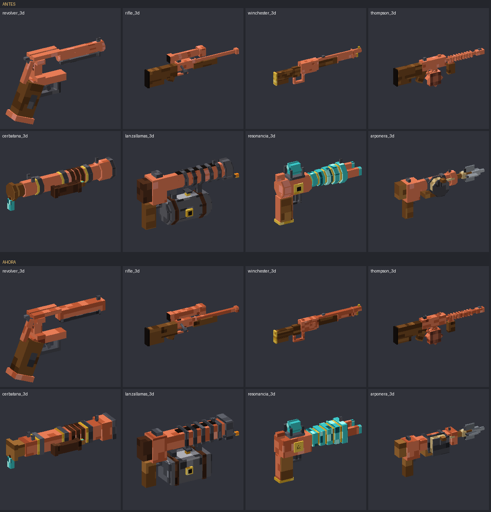
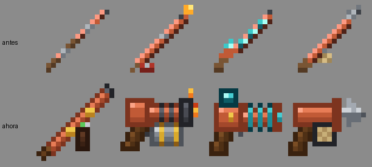

# Test de estilo de las armas: resultados y recomendaciones

> **Estado (12/11/2026):** elegida la versión **B (bloques de 0,5 px)** para las 13 armas, y ya está en
> `models/item/armas3d/` (también los accesorios, las piezas de la Gatling y las cuatro fases del óxido). El tambor del
> revólver y su culote siguen como estaban, porque el código los gira y coloca las balas en posiciones fijas. Test:
> 0 errores, 0 avisos. Las versiones descartadas siguen en `propuestas/` y la comparación en
> `docs/estilo/versiones_armas.html`. Las cifras de abajo son de la primera prueba (cañones cuadrados), que se descartó.

Revisión del 12 de noviembre de 2026. Se han mirado los 14 modelos 3D, sus materiales y los iconos de inventario con
`herramientas/render_modelo.py` (dibuja los modelos sin abrir el juego) y `herramientas/test_estilo_minecraft.py` (el test
automático, que ahora también corre en el workflow «Compilar»).

## Resultado

| | Antes | Ahora |
|---|---|---|
| Errores de estilo | **73** | **0** |
| Avisos | 12 | 5 |
| Cañones octogonales (cajas giradas 45°) | 68 modelos | 0 (solo el tambor del revólver, a propósito) |
| Tonos por material | 3 | 5 |
| Iconos que son palitos de 1 px | 4 armas (×4 fases) | 0 |
| Piezas de menos de 0,25 px | 51 | 0 |





## Por qué no parecían de Minecraft

1. **Materiales planos.** El cobre, la madera y el hierro tenían solo 3 tonos con manchas cuadradas al azar. De cerca y en
   la mano parecía plástico de color liso. Vanilla usa rampas de 4-6 tonos con dibujo: vetas, poros, brillos.
2. **Cañones redondeados.** Los octógonos (dos cajas rectas y dos giradas 45°) dan un aspecto de tubo liso, más de mod de
   armas realista que de Minecraft. El tridente, el catalejo y la ballesta tienen piezas cuadradas.
3. **Iconos de las cuatro armas nuevas.** La cerbatana, el lanzallamas, la pistola de resonancia y la arponera eran líneas
   diagonales de un píxel: no se parecían a su modelo (que tiene empuñadura, depósito, bobinas, carrete) y en la barra se
   confundían entre ellas.
4. **Piezas finísimas.** Había varillas y tiras de 0,02–0,2 px: de lejos parpadean y no muestran ni un píxel entero.

## Qué se ha cambiado

- `herramientas/texturas_estilo_mc.py`: los materiales nuevos (cobre 0-3, hierro, acero, latón, madera, madera de la
  Gatling y cuero). Cinco tonos, metal cepillado, vetas de madera y, en el cobre expuesto y el erosionado, pintas de la
  fase anterior como el cobre de vanilla. Es determinista: si se vuelve a ejecutar, sale lo mismo.
- `herramientas/canones_cuadrados.py`: convierte cada octógono en una caja cuadrada y ensancha hasta 0,25 px lo que era
  más fino. Es idempotente. `generar_tambor.octogono` y `octogono_x` ya generan cajas (con `cuadrado=False` vuelve el
  octógono, que es lo que usa el tambor del revólver). `redondear_canones.py` queda bloqueado: hacía lo contrario.
- `herramientas/iconos_armas_nuevas.py`: los iconos nuevos de las cuatro armas, uno por fase de óxido.
- `herramientas/test_estilo_minecraft.py`: el test. Falla si hay materiales de menos de 4 tonos, octógonos o iconos
  palito, y avisa de poco contraste, piezas finas, texturas estiradas y contornos que no son oscuros.

La geometría no se ha movido (solo se cuadran secciones y se ensanchan piezas finas), así que los pivotes del código
(tambor del revólver, cañones y manivela de la Gatling) y la mano en primera persona siguen valiendo.

## Recomendaciones (por prioridad)

1. **Probarlo en el juego antes de publicar.** El render de aquí no tiene la iluminación ni la perspectiva del juego. Hay
   que mirar sobre todo la primera persona del rifle y de la Winchester: el cañón cuadrado tapa un poco más la mira. Si
   molesta, se baja 0,1 px la parte de arriba del cañón.
2. **Rehacer los iconos del Thompson y la Winchester.** Pasan el test, pero a 16 px se parecen mucho entre ellos (dos
   diagonales marrón y cobre). El Thompson se distinguiría con el tambor redondo bien marcado debajo y la culata más corta;
   la Winchester, con la palanca de latón.
3. **Unificar la orientación de los iconos.** Ahora unos van en horizontal (revólver, Derringer, escopeta, Gatling y las
   tres pistolas nuevas) y otros en diagonal (las armas largas). Está bien como regla (cortas en horizontal y largas en
   diagonal, como la ballesta), pero conviene escribirla en el README para las armas futuras.
4. **Densidad de píxeles.** Los modelos usan 1 texel por píxel de modelo, pero muchas piezas miden 0,3–0,8 px, así que solo
   enseñan un trozo de un texel. Para un aspecto 100 % vanilla habría que rehacer las armas a escala doble con piezas de
   píxeles enteros y la mitad de `scale` en `display`. Es mucho trabajo y obliga a cambiar los pivotes del código
   (`RevolverTambor`, `GatlingRenderer`): solo merece la pena si se rehace un arma desde cero.
5. **Avisos que quedan** (5): una cara del estrangulador de la escopeta (en las cuatro fases) y otra de la cerbatana tienen
   la textura comprimida más del doble. No se nota en el juego; se arregla recalculando su UV en el generador.
6. **Contorno de los iconos de munición.** Las balas y los cartuchos están bien, pero la metralla y los cargadores del
   Thompson tienen el contorno muy claro. Se pueden pasar por el mismo test añadiéndolos a la lista `ARMAS`.
7. **Lo que falta del último commit:** las líneas de mira (Apuntado) de las armas nuevas y la prueba en el juego.

## Cómo repetir el test

```sh
python3 -m pip install pillow numpy
python3 herramientas/test_estilo_minecraft.py      # sale con error si algo falla
python3 herramientas/render_modelo.py common/src/main/resources/assets/copperslug/models/item/armas3d/rifle_3d.json rifle.png
```
